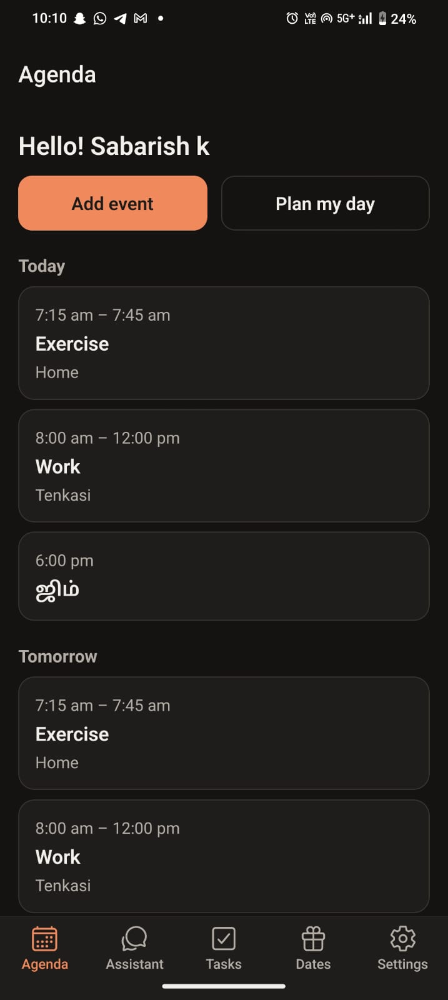
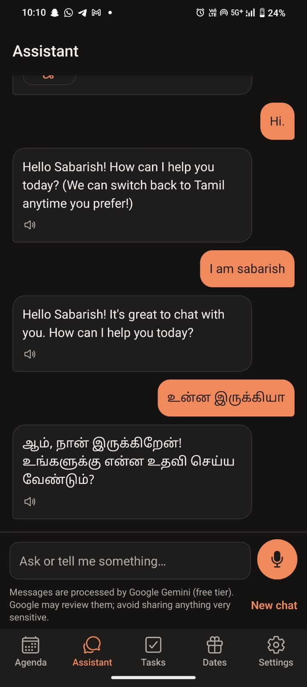
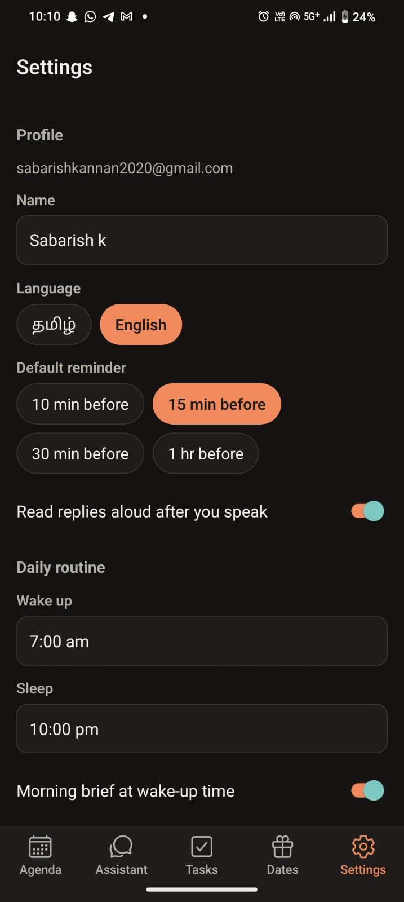

# Anbu AI

A Tamil-first, bilingual (Tamil / English / Tanglish) voice-powered personal assistant for schedules,
reminders, tasks and important dates. The product name is configurable (`APP_NAME`, and `name` in
`apps/mobile/app.json`).

Architecture and decisions: [docs/architecture.md](docs/architecture.md). Deploying and building:
[docs/release.md](docs/release.md).

## Screenshots

Running as an installed app on an Android phone:

| Agenda                                                                                                  | Assistant (English and Tamil)                                                                                 | Settings                                                                                                                   |
| ------------------------------------------------------------------------------------------------------- | ------------------------------------------------------------------------------------------------------------- | -------------------------------------------------------------------------------------------------------------------------- |
|  |  |  |

## Download (Android)

**[Download the APK](https://expo.dev/artifacts/eas/Xmy6agUvlzzvCLa9g-1TJulSa-7W6bhnc0p2M-_ErvE.apk)**
(built with EAS, `preview` profile). Open the link on the phone and allow installing from the
browser when Android asks.

The app needs an Anbu AI API to talk to; it is not a hosted service. Run the API on a computer
(see [Running](#running)), then enter its address on the sign-in screen (Server address, e.g.
`http://192.168.1.5:4000`). It can be changed later in Settings.

## Status

All phases are built, and phases 2–9 have been tested on an Android phone (Expo Go and the
installed APK). iOS has not been tested on a device yet.

| Phase                                                                 | State   |
| --------------------------------------------------------------------- | ------- |
| 0. Discovery & architecture                                           | ✅ Done |
| 1. Foundation (monorepo, schema, /health, mobile ↔ API)               | ✅ Done |
| 2. Auth, events, tasks, important dates, conflicts                    | ✅ Done |
| 3. Reminders (worker, local notifications, due/snooze)                | ✅ Done |
| 4. Assistant (Gemini tool-calling, confirmations, chat tab)           | ✅ Done |
| 5. Voice (speak to the assistant, replies read aloud)                 | ✅ Done |
| 6. Memory, day planning, morning brief                                | ✅ Done |
| 7. Hardening + release prep (limits, account export/delete, push, CI) | ✅ Done |
| 8. Skip or move one occurrence of a repeating event                   | ✅ Done |
| 9. Done/Snooze on notifications, app unit tests                       | ✅ Done |
| 10. Installable Android app (EAS build, server address setting)       | ✅ Done |

## Repository layout

```
apps/mobile        Expo (SDK 57) + React Native + Expo Router app
services/api       Express 5 + TypeScript API, Prisma 7 + PostgreSQL
packages/shared    Types, zod schemas and constants shared by app and API
docs/              Architecture and decisions
```

npm workspaces; run all install commands from the repository root.

## Prerequisites

- Node.js ≥ 22.12 (developed on 24.14) and npm
- PostgreSQL 16+ running locally (developed on 18)
- Expo Go (or the [APK](#download-android)) on an Android phone and/or iPhone, on the same Wi-Fi as
  the development computer

## Setup

```bash
npm install
cp .env.example services/api/.env      # then set your Postgres password and JWT_ACCESS_SECRET
npm run db:migrate                      # creates the anbu_ai database and applies migrations
npm test                                # migrates the anbu_ai_test database, then runs API tests
```

`.env` files are git-ignored. Never commit real credentials.

## Running

```bash
npm run dev:api       # API on http://0.0.0.0:4000 (GET /health)
npm run dev:mobile    # Expo dev server; scan the QR code with Expo Go
```

In the app: create an account, then use the Agenda, Tasks, Dates and Settings tabs. The UI is in
Tamil by default; switch to English on the sign-in screen or in Settings. Sessions are kept in the
device's secure storage. Allow notifications when asked: reminders for the next 72 hours are
scheduled on the phone, and fired reminders also appear under "Due now" on the Agenda. The API runs
the reminder worker itself, so keep `npm run dev:api` running.

To enable the assistant, add `GEMINI_API_KEY` (from https://aistudio.google.com/apikey) to
`services/api/.env` and restart the API. Without it the Assistant tab says it is not set up and
everything else works. With the key set, the Assistant tab also has a microphone button: tap, speak in
Tamil or English, tap Send. Note the privacy terms of Gemini's free tier in `.env.example`.

To reach the API from outside your Wi-Fi (e.g. a phone on mobile data), run `npm run tunnel` for a
temporary Cloudflare HTTPS address and start Expo with `EXPO_PUBLIC_API_URL` set to it; see
[docs/release.md](docs/release.md#0-hosting-on-your-own-pc-with-cloudflare-tunnel).

The app finds the API automatically at the dev computer's LAN IP on port 4000. To use a different
API, set `EXPO_PUBLIC_API_URL` before starting Expo. On Windows, allow Node.js through the firewall
on private networks the first time, otherwise the phone cannot reach the API.

## Quality checks

```bash
npm run typecheck     # all workspaces
npm run lint          # ESLint (flat config)
npm run format:check  # Prettier
npm test              # API unit + integration tests (Vitest, real test database)
```
